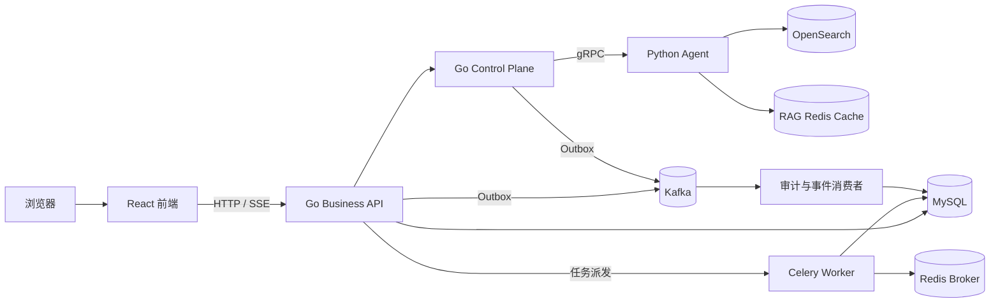

# 算法实验智能平台与 Knowledge Agent

这是一个面向算法实验管理和智能分析的全栈工程项目。项目将实验数据管理、训练、验证、NAS 搜索、指标分析与 AI Agent 串联起来，并通过 Go 控制面、gRPC、Celery、Redis、Kafka、MySQL 和 OpenSearch 实现可靠的异步执行、流式输出、事件审计与故障恢复。

本仓库仅公开源代码、系统架构、部署方式和测试，不包含实验数据、模型权重、完整知识资料、运行日志或任何真实密钥。

## 核心能力

- Go 业务接口：登录会话、角色权限、资源隔离、实验配置与任务管理。
- 跨语言调用：Go 通过 gRPC 调用 Python Agent 和算法计算服务。
- 异步任务：Celery + Redis 承载训练、验证、NAS 和评测任务，支持队列隔离、延迟确认、去重与故障重试。
- 可靠控制面：状态机、数据库租约、Redis 可续期锁、Fencing Token 和 CAS 条件更新共同保证任务并发安全。
- 流式 Agent：事件先持久化再通过 SSE 推送，支持断线续传，并对模型增量进行微批写入。
- 可靠事件链路：Transactional Outbox 将运行事件和实验事件发布到 Kafka，消费端通过事件唯一编号实现幂等处理。
- RAG：OpenSearch BM25/HNSW 双路召回、RRF 融合、神经重排、证据评估与来源追踪。
- 安全工具调用：模型只生成操作提案，用户批准后由确定性控制面执行。

## 系统架构



## 目录说明

| 目录 | 作用 |
|---|---|
| `services/go-business-api` | 实验平台统一业务接口与实验事件消费 |
| `services/go-control-plane` | Agent Run 状态机、租约、锁、事件与后台执行 |
| `app` | Python Agent、RAG、gRPC 服务与 Celery 任务 |
| `ml` | 训练、验证、NAS 和特征算法代码 |
| `proto` | gRPC 接口定义及生成代码 |
| `web/frontend` | React 前端 |
| `tests` | Python 契约、数据库和检索测试 |
| `configs` | 不含真实数据的实验配置模板 |
| `evals` | 版本化 Agent 评测样例 |
| `deploy/production` | 生产部署入口、反向代理和部署说明 |

## 本地启动

要求：Linux/macOS、Docker、Docker Compose v2，以及 `x86_64` 运行环境。若不使用 Docker 单独运行前端，需要 Node.js 22.13 以上版本。

```bash
cp .env.example .env
```

编辑 `.env`，至少填写大模型密钥和本地开发密码。真实 `.env` 已被 Git 忽略，禁止提交。

```bash
docker compose up -d --build
```

默认入口：

- 前端：`http://localhost:5173`
- Go Business API：`http://localhost:8080`
- Go Control Plane：`http://localhost:8081`

实验数据、模型和知识库不包含在公开仓库中。需要运行对应功能时，请自行准备 `data`、`model_ckp` 和 `rag_knowledge_base` 目录；真实训练还需根据算法配置准备相应算力。

生产部署说明见 [`deploy/production/README.md`](deploy/production/README.md)。

## 测试

Python：

```bash
python -m pytest tests
```

Go Business API：

```bash
cd services/go-business-api
go test ./...
```

Go Control Plane：

```bash
cd services/go-control-plane
go test ./...
```

前端：

```bash
cd web/frontend
pnpm install
pnpm test:run
pnpm build
```

编排配置检查：

```bash
docker compose config --quiet
```
